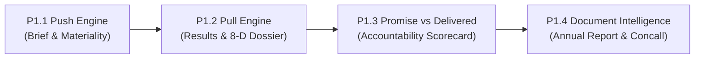

# FINN — Financial Intelligence & Investment Research Agent

[](https://www.python.org/)
[](https://fastapi.tiangolo.com/)
[](https://react.dev/)
[](https://www.typescriptlang.org/)
[](LICENSE)
[]()

> **FINN** is an institutional-grade, evidence-grounded financial intelligence platform for Indian equities (NSE/BSE). Built on a strict principle of **evidence-first research with explicit uncertainty**, FINN anchors every number, management quotation, and forward commitment to official primary disclosures (exchange filings, audited annual reports, and verified earnings call transcripts).

**Repository**: [https://github.com/amankesharwani9919/FINN](https://github.com/amankesharwani9919/FINN)

---

## Table of Contents
1. [Core Features & Architecture](#core-features--architecture)
2. [Primary Source Integrity & Evidence-First Research](#primary-source-integrity--evidence-first-research-with-explicit-uncertainty)
3. [The Four Engine Milestones](#the-four-engine-milestones)
4. [Technology Stack](#technology-stack)
5. [Quick Start & Local Setup](#quick-start--local-setup)
6. [API Reference](#api-reference)
7. [Running Tests & Audit Verification](#running-tests--audit-verification)
8. [Production Deployment Guide (₹0 Budget)](#production-deployment-guide-0-budget)
9. [Project Layout](#project-layout)
10. [License](#license)

---

## Core Features & Architecture

FINN operates across two foundational paradigms:

### 1. Push Engine: Market Brief & Materiality Intelligence (P1.1)
- **Deterministic 15-Category Classifier**: Classifies exchange announcements based on NSE regulatory labels and verified filing text.
- **Materiality Scoring Matrix**: Transparent formula combining base event gravity, portfolio weight, and intraday market reaction:
  $$\text{Score} = \text{Base Points} + \text{Weight Points} + \text{Market Reaction Points} - \text{Confidence Penalty}$$
- **Scoring Gates**: High-impact priority gates prevent minor routine items from ever appearing in *Needs you*.
- **Portfolio Tracking**: End-of-day (EOD) tracking of institutional portfolio holdings with 20-day volume multiples and session price moves.

### 2. Pull Engine: On-Demand Fundamental Research & Audit (P1.2, P1.3, P1.4)
- **Quarterly Results Card (Regulation 33)**: Consolidated vs. Standalone statement comparison, QoQ & YoY metrics, EBITDA derivations, and statutory reconciliation notes.
- **8-Dimension Research Dossier**:
  1. *Business Snapshot*: Operational scale, segment mix, and multi-engine platforms.
  2. *Financial Snapshot*: Full-year statutory turnover, EBITDA, PAT, and line-item reconciliations.
  3. *Trajectory & Direction*: Segment-level margin expansion, compounding, and headwinds.
  4. *Balance Sheet & Leverage*: Statutory borrowings, deferred spectrum liabilities, capital commitments, and DSCR.
  5. *Cash Quality*: Cash from operations (CFO), capex, free cash flow (FCF), and CFO/PBT conversion.
  6. *Narrative vs. Numbers*: Management claims audited against statutory balance sheet facts.
  7. *Management Guidance*: Explicit targets, relative time contexts, and status tracking.
  8. *Bull vs. Bear Case*: Primary institutional moats vs. core structural risks.
- **Promise vs. Delivered Engine (P1.3)**: Multi-quarter accountability tracking comparing initial management commitments with subsequent actual disclosures, governed by strict chronology and eligibility audits.
- **Annual Report & Concall Intelligence (P1.4)**: Deterministic extraction from audited Annual Reports and Earnings Call Transcripts, complete with speaker attribution, verbatim quotes, confidence scores, and management divergence flags.

### 3. Data Scope & Coverage Invariants
- **17-Company Institutional Portfolio**: Active monitoring across 17 symbols (`HDFCBANK`, `RELIANCE`, `TCS`, `BAJFINANCE`, `INFY`, `ITC`, `LT`, `MARUTI`, `SUNPHARMA`, `TITAN`, `DIXON`, `ETERNAL`, `PERSISTENT`, `POLYCAB`, `TRENT`, `KPITTECH`, `CDSL`) with official exchange announcements and EOD market quotes.
- **Deep-Dive Fundamental Research (RELIANCE)**: The comprehensive 8-Dimension research dossier, interactive citation inspector, and Promise vs. Delivered evaluation are populated for **RELIANCE** as the flagship demonstration (anchored to 46 verified primary citations). Other portfolio companies display transparent `UNAVAILABLE` handling under FINN's evidence-first research with explicit uncertainty principles until their offline ingestion pipelines are run.
- **Historical Snapshot & Snapshot-Aware Filtering**: Preloaded frozen data snapshot (NSE Q2 FY27). Announcements are as of October 31, 2026 (22:16 IST) and EOD prices are as of October 30, 2026 (Friday close). Brief filters (`24h`, `3d`, `7d`, `30d`) are snapshot-aware and anchored to the latest available snapshot filing rather than wall-clock time.
- **Promise vs. Delivered Limitations**: 9 commitments are audited for RELIANCE. 3 non-promissory items (strategic intentions, historical milestones) are excluded, 2 are active in-progress multi-year targets, and 4 are unverifiable without subsequent primary disclosures. The delivery score is honestly reported as `N/A` (deferred with an explicit statistical caveat) rather than presenting a fabricated score.

---

## Primary Source Integrity & Evidence-First Research with Explicit Uncertainty

FINN rejects synthetic generation, ungrounded web scraping, and third-party opinions. Every metric and insight is strictly traceable to official corporate disclosures:

1. **Exact Page/Slide Provenance**: Every claim includes the exact document name, document type, and PDF page number (e.g. `📘 Annual Report P.100`, `🎙️ Concall Transcript P.34`, `📊 Pres. Slide 12`, `📑 Results P.17`).
2. **Verbatim Excerpts**: Primary source text is retained verbatim for audit scrutiny.
3. **Speaker Role Attribution**: Concall quotes distinguish between `MANAGEMENT` and `ANALYST`, recording speaker name and executive designation.
4. **Honest Data States**:
   - `EOD`: Official end-of-day market close for completed sessions.
   - `DELAYED`: Corporate announcements fetched from NSE within 6 hours.
   - `CACHED`: Out-of-date snapshot or weekend/holiday snapshot.
   - `UNAVAILABLE`: Clearly indicated when disclosures have not yet been extracted (no fabrication).

---

## The Four Engine Milestones



### Milestone Summary
- **P1.1**: Deterministic exchange filing classification, materiality priority gates, and portfolio monitoring.
- **P1.2**: Automated extraction of Regulation 33 results and synthesis of the 8-Dimension research dossier.
- **P1.3**: Commitment tracking engine with chronological promise-actual matching and delivery scorecard.
- **P1.4**: Ingestion of official Integrated Annual Reports and Concall Transcripts with interactive citation inspection and management review warnings.

---

## Technology Stack

- **Backend**:
  - Python 3.12
  - **FastAPI**: Asynchronous high-performance REST API
  - **SQLite**: Zero-maintenance embedded database with non-destructive migrations
  - **pdftotext (`poppler-utils`)**: Local, deterministic `-layout` text extraction (₹0 budget, no paid APIs)
  - **Pytest**: 234 comprehensive unit and integration tests
- **Frontend**:
  - **React 18** & **TypeScript 5.5**
  - **Vite 6**: Fast production bundler and dev server
  - **Tailwind CSS v4**: Mobile-first, responsive institutional UI
- **Infrastructure**:
  - Standalone single-process deployment option (FastAPI serves both API and React static SPA)
  - Zero external SaaS dependencies

---

## Quick Start & Local Setup

### Prerequisites
- Python 3.12+
- Node.js 18+ (tested on v24.11.1) and npm
- `poppler-utils` (for `pdftotext`)

### 1. Clone & Set Up Python Environment
```bash
# Clone the repository
git clone https://github.com/amankesharwani9919/FINN.git
cd FINN

# Create and activate virtual environment
python3.12 -m venv .venv
source .venv/bin/activate

# Install backend dependencies
pip install -r requirements.txt
pip install -r requirements-dev.txt
```

### 2. Build Frontend Production Assets
```bash
# Install frontend dependencies and build production static bundle
cd frontend
npm install
npm run build
cd ..
```
The build outputs directly to `backend/static/`.

### 3. Start the Server (Single Process)
Run the application using Uvicorn:
```bash
PYTHONPATH=backend uvicorn finn.api:app --host 0.0.0.0 --port 8000
```
Open **`http://localhost:8000`** in your browser.

### 4. Development Mode (Optional)
If you wish to develop with hot-reloading:
```bash
# Terminal 1: Backend API
PYTHONPATH=backend uvicorn finn.api:app --reload --port 8000

# Terminal 2: Frontend Vite Server
cd frontend
npm run dev
# Open http://localhost:5173 (proxies /api to localhost:8000)
```

---

## API Reference

### System & Feeds
- `GET /api/status`: Returns data feed health (prices status, filings freshness, ingest issues).
- `GET /api/scoring`: Explains materiality base points, weight formulas, and gate thresholds.

### Brief & Portfolio
- `GET /api/brief?window=24h`: Corporate announcements for chosen window (`24h`, `3d`, `7d`, `30d`), ranked by materiality tier (*Needs you*, *Worth knowing*, *Routine*).
- `GET /api/portfolio`: Institutional holdings with weights, close prices, volume multiples, and 7-day filing activity.

### Results & Financials
- `GET /api/results/{symbol}`: Structured quarterly financial results for a tracked company.
- `GET /api/results/filing/{filing_id}`: Full Regulation 33 quarterly results card with line-item reconciliations.

### Fundamental Research Dossier
- `GET /api/research/search?q={query}`: Autocomplete search for listed companies.
- `GET /api/research/{symbol}`: Synthesized 8-dimension fundamental research dossier backed by verified citations.

### Promise vs. Delivered (P1.3)
- `GET /api/commitments/{symbol}`: Management commitments, targets, actual outcomes, and quarter-by-quarter evaluations.
- `GET /api/commitments/{symbol}/summary`: Summary delivery scorecard, eligible evaluated counts, and statistical caveats.

---

## Running Tests & Audit Verification

FINN includes a comprehensive, deterministic test suite:

```bash
# Run the complete backend test suite (234 tests)
PYTHONPATH=backend pytest backend/tests/ -v

# Run frontend TypeScript type-checking and bundling
npm run --prefix frontend build

# Inspect database integrity
python -c "import sqlite3; con = sqlite3.connect('data/finn.db'); print(con.execute('PRAGMA integrity_check').fetchall())"
```

For the complete pre-deployment verification details, review [report.md](report.md).

---

## Production Deployment Guide (₹0 Budget)

FINN is architected for zero-maintenance, zero-cloud-cost ($0 / ₹0 budget) deployment using a **single-container unified snapshot** model.

### 1. Single-Container Architecture
- **Unified Process**: A single Python/FastAPI process serves both the JSON API (under `/api/*`) and the pre-compiled React single-page application (`backend/static`).
- **No Split Hosting Complexity**: Frontend assets and backend API share the exact same domain origin, eliminating CORS requirements, cross-service network hops, and multi-service management.
- **Dynamic Port Binding**: The container binds to `0.0.0.0` and listens on `${PORT:-8000}`, fully compatible with cloud platforms like Render, Koyeb, Fly.io, or Hugging Face Spaces.

### 2. Snapshot-Based, Read-Only Production Behavior
- **Bundled SQLite Database**: The production image embeds the verified, audited database snapshot (`data/finn.db`) directly into `/app/data/finn.db`.
- **Zero Runtime Mutations**: Public user interactions (searching companies, exploring the 8-dimension dossier, auditing promises, and inspecting citations) perform pure read-only SQL queries (`SELECT`). No persistent disk write volume is required.
- **Deterministic & Resilient**: Container restarts, redeployments, or cold reboots reload the exact same verified primary disclosures with zero data drift or corruption risk.

### 3. How to Refresh Data Locally & Redeploy
Because Indian exchange portals (NSE) actively block datacenter and cloud IP addresses via anti-bot firewalls, ingestion must always run on an operator's local machine:

1. **Ingest Latest Market & Announcement Feeds Locally**:
   ```bash
   python -m finn.cli ingest-announcements --days 30
   python -m finn.cli ingest-prices
   ```
2. **Synthesize Dossiers & Audit Commitments**:
   ```bash
   PYTHONPATH=backend python -c "from finn.db import init_db; init_db()"
   ```
3. **Verify Provenance & Invariants**:
   ```bash
   PYTHONPATH=backend pytest backend/tests/ -q
   ```
4. **Build & Deploy Container Snapshot**:
   ```bash
   # Build container with multi-stage build (compiles frontend + packages finn.db)
   docker build -t finn:latest .

   # Run container locally or push to your cloud registry
   docker run -p 8000:8000 -e PORT=8000 finn:latest
   ```

### 4. Required Environment Variables & Startup Behavior
- `PORT`: Web server listening port (injected automatically by cloud hosts; defaults to `8000`).
- `FINN_DB`: Filesystem path to the SQLite database (defaults to `/app/data/finn.db` inside Docker, `data/finn.db` in local development).
- `PYTHONPATH`: Configured as `/app/backend` so that `import finn` resolves cleanly.
- `PYTHONUNBUFFERED`: Set to `1` for immediate stdout/stderr logging in cloud consoles.

### 5. Free-Hosting Limitations & Expectations
- **Cold Starts**: On free container tiers (e.g., Render Free Web Services), instances spin down after 15 minutes of inactivity. The first visitor request incurs a ~50-second wake-up time.
- **Ephemeral Filesystem**: Free platforms do not provide persistent disk volumes. Any runtime file modifications or background ingestion attempts in the cloud will be erased upon container restart. All updates must follow the local ingest $\rightarrow$ redeploy snapshot workflow.
- **Memory Ceiling**: The FastAPI + React bundle runs within ~90 MB to 120 MB RAM, well inside the standard 512 MB free tier quota.

### 6. Render Deployment Walkthrough
To deploy the application to Render ($0 free tier):
1. Push to your GitHub repository: `https://github.com/amankesharwani9919/FINN`.
2. In the [Render Dashboard](https://dashboard.render.com/), click **New +** $\rightarrow$ **Web Service**.
3. Connect your repository: `https://github.com/amankesharwani9919/FINN`.
4. Configure service settings:
   - **Environment / Runtime**: `Docker` (Render automatically detects the root `Dockerfile`).
   - **Instance Type**: `Free`.
   - **Health Check Path**: `/api/status`.
5. Click **Deploy Web Service**. Render builds the multi-stage image (compiling the React frontend and bundling `data/finn.db`) and starts the service.

---

## Project Layout

```
finn-p0.2/
├── backend/
│   ├── finn/
│   │   ├── api.py                    # FastAPI routes & static file mounting
│   │   ├── annual_report_extract.py  # Deterministic Annual Report extractor
│   │   ├── transcript_extract.py     # Deterministic Concall Transcript extractor
│   │   ├── research_extract.py       # 8-Dimension Dossier synthesis engine
│   │   ├── commitments_extract.py    # Management guidance & outcome extractor
│   │   ├── commitments_eval.py       # Commitment status evaluation logic
│   │   ├── classify.py               # 15-category announcement classifier
│   │   ├── scoring.py                # Materiality scoring engine
│   │   ├── db.py                     # SQLite database session & migrations
│   │   └── models.py                 # Pydantic data schemas
│   ├── static/                       # Production frontend build assets
│   └── tests/                        # 234 unit & integration test files
├── frontend/
│   ├── src/
│   │   ├── components/
│   │   │   ├── ResearchView.tsx       # 8-Dimension dossier & citation inspector
│   │   │   ├── CommitmentsSection.tsx # Promise vs Delivered UI
│   │   │   ├── BriefView.tsx          # Materiality-tiered filings brief
│   │   │   ├── PortfolioView.tsx      # Portfolio tracking & metrics
│   │   │   └── ResultsCard.tsx        # Regulation 33 results card
│   │   ├── api.ts                     # TypeScript types and fetch client
│   │   └── App.tsx                    # Top navigation & layout container
│   ├── package.json
│   └── vite.config.ts
├── data/
│   ├── finn.db                       # Active SQLite database
│   ├── documents/RELIANCE/           # Primary official source PDFs
│   └── finn.db.bak-*                 # Timestamped safety backups
├── report.md                         # Pre-deployment audit report
└── README.md                         # Project documentation
```

---

## License

This project is licensed under the MIT License — see the [LICENSE](LICENSE) file for details.
